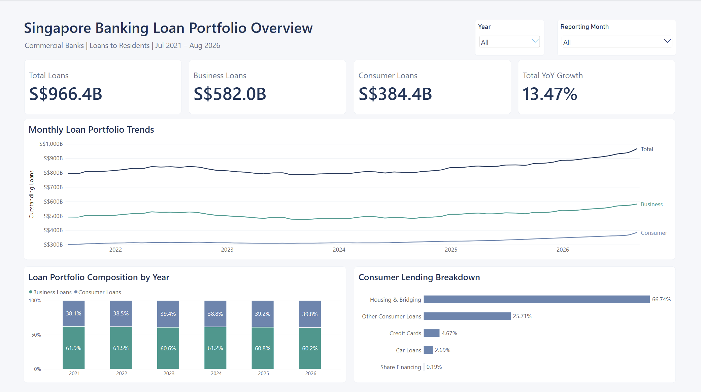
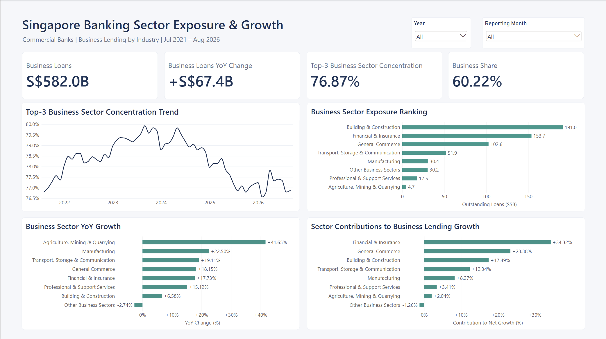

# Singapore Banking Loan Portfolio & Sector Exposure Analytics

An end-to-end data analytics project examining Singapore commercial banks' outstanding loans to residents — cleaned and reshaped with Python, analyzed with DuckDB SQL, and visualized in an interactive Power BI dashboard.

## 1. Project Overview

**Business problem:** Bank balance-sheet composition — how much is lent to businesses versus consumers, which industries carry the largest exposure, and how concentrated that exposure is — is core information for credit risk, sector strategy, and macro-financial monitoring in Singapore's banking system.

**Analytical objective:** Build a reproducible pipeline that cleans official MAS/SingStat lending data, quantifies portfolio composition and growth, and presents the results as an interactive dashboard suitable for exploring trends by period and sector.

**Why Singapore banking:** Singapore is a major regional financial hub, and commercial bank lending to residents is a closely watched indicator of credit conditions across its business and consumer sectors.

**Reporting period:** July 2021 – August 2026 (62 consecutive monthly observations, the current MAS/SingStat reporting basis following a mid-2021 methodology revision).

## 2. Key Business Questions

1. How has the total loan portfolio changed over the reporting period?
2. How has the business-versus-consumer lending composition evolved?
3. Which business sectors account for the largest loan balances?
4. How has top-three sector concentration evolved over time?
5. Which sectors contributed most to recent business lending growth?

## 3. Dashboard

**Page 1 — Portfolio Overview**



Total/business/consumer loan KPIs, the latest 12-month growth rate, a monthly trend line from Jul 2021, year-over-year business-vs-consumer composition, and a consumer lending breakdown — with Year and Reporting Month slicers.

**Page 2 — Sector Exposure & Growth**



Business lending KPIs, a ranked sector exposure chart, the top-3 sector concentration trend, sector-level 12-month growth rates, and each sector's contribution to net business lending growth.

## 4. Key Findings

All figures as of **August 2026**, the latest month in the dataset, cross-validated against the SQL results in `results/`.

- **Total loans** stood at **S$966.4B**, up **+13.47%** year-over-year.
- **Business loans** were **S$582.0B** and **consumer loans** **S$384.4B** — business lending held a **60.22% share** of the total portfolio.
- The **top three business sectors** (Building & Construction, Financial & Insurance, General Commerce) held a **76.87% concentration** of business lending — a share that has moved within a narrow band since 2021 rather than trending sharply in one direction.
- **Financial & Insurance Activities** grew **+S$23.15B** over the latest 12 months (a **sector growth rate** of +17.73%) and was the single largest driver of the business book's expansion, accounting for **34.32% of the net 12-month increase in business loans** — a distinct measure from its share of the book or its own growth rate: *contribution to net growth* reflects how much of the portfolio's total dollar increase came from this one sector.
- **Housing & Bridging loans** remained the dominant consumer category, at **66.74% of consumer lending**.

Full findings, validation detail, and sector-by-sector breakdowns are in `docs/STAGE_2_FINDINGS.md` and `docs/STAGE_3_SQL_FINDINGS.md`.

## 5. Tools and Methodology

- **Python / pandas** — raw data cleaning, hierarchy parsing, long-format reshaping, and exploratory analysis (`scripts/clean_data.py`, `notebooks/01_eda.ipynb`).
- **DuckDB SQL** — joins, CTEs, window functions (`LAG`, `ROW_NUMBER`), conditional aggregation, ranking, and growth-contribution analysis across 7 analytical queries (`sql/`, `scripts/run_sql_analysis.py`).
- **Power BI** — a star-schema semantic model (fact + two dimension tables), 24+ DAX measures, and a two-page interactive dashboard (`powerbi/`).
- **Git / GitHub** — version control and publication (this repository).

## 6. Project Structure

```
03_Singapore_Finance_Analytics/
├── data/
│   ├── raw/                   # Original data.gov.sg CSV exports (unmodified)
│   └── processed/             # Cleaned fact table + category dimension
├── scripts/
│   ├── clean_data.py          # Raw -> processed data cleaning & validation
│   ├── run_sql_analysis.py    # Executes the DuckDB SQL analysis
│   └── prepare_powerbi_data.py # Builds the Power BI dimension CSVs
├── sql/                       # 7 DuckDB SQL queries
├── results/                   # 7 SQL query result CSVs
├── notebooks/
│   └── 01_eda.ipynb           # Exploratory data analysis
├── figures/                   # 6 EDA charts (PNG)
├── powerbi/
│   ├── Singapore_Banking_Loan_Analytics.pbix
│   ├── screenshots/           # Dashboard page screenshots
│   ├── dim_category.csv       # Power BI category dimension
│   ├── dim_month.csv          # Power BI month dimension
│   └── POWER_BI_BUILD_GUIDE.md
├── docs/                      # Stage-by-stage methodology & findings
├── README.md
└── requirements.txt
```

## 7. Reproducibility

```bash
pip install -r requirements.txt
python scripts/clean_data.py          # data/raw -> data/processed (with validation)
python scripts/run_sql_analysis.py    # runs sql/*.sql, writes results/*.csv
python scripts/prepare_powerbi_data.py  # builds powerbi/dim_category.csv, dim_month.csv
```

`Singapore_Banking_Loan_Analytics.pbix` contains an already-imported data model (not a live connection) built from the CSVs above. It was authored on Windows via Parallels against local Mac file paths; opening it on another machine and clicking **Refresh** will require updating the Power Query source paths to point at your local copy of `data/processed/` and `powerbi/`. The dashboard does not update automatically — refresh is a manual step after re-running the pipeline above.

## 8. Data Sources and Attribution

- **Primary dataset:** [Commercial Banks: Loans And Advances To Residents By Industry](https://data.gov.sg/datasets/d_af0415517a3a3a94b3b74039934ef976/view) — the only dataset used for analytical results in this project.
- **Supporting dataset (inspection only, not used analytically):** [Commercial Banks: Assets And Liabilities](https://data.gov.sg/datasets/d_f357c61441e2850ca4eae05813ebd37b/view)

Published by the **Singapore Department of Statistics (SingStat)**, sourced from the **Monetary Authority of Singapore (MAS)**. Data retrieved **9 November 2026**.

Licensed under the [Singapore Open Data Licence](https://developers.data.gov.sg/open-data-licence), which permits redistribution subject to its terms and required attribution.

## 9. Limitations

- All loan figures are **end-of-period outstanding stocks**, not new loan origination flows.
- The reporting series begins July 2021 following a MAS methodology revision (Notices 610/1003); earlier, discontinued series are not included.
- Published figures carry small (~S$0.1–0.2M) rounding residuals at subtotal levels.
- Sector concentration is a descriptive balance-composition measure, not a direct credit-risk or default-probability measure.
- No causal conclusions are drawn from observed trends (e.g., no claims about what drove growth).
- Analysis reflects data available through **August 2026** only.

## 10. Disclaimer

This is an independent portfolio project for educational and demonstration purposes. It is **not affiliated with or endorsed by** the Monetary Authority of Singapore (MAS), the Singapore Department of Statistics (SingStat), or the Singapore Government.
